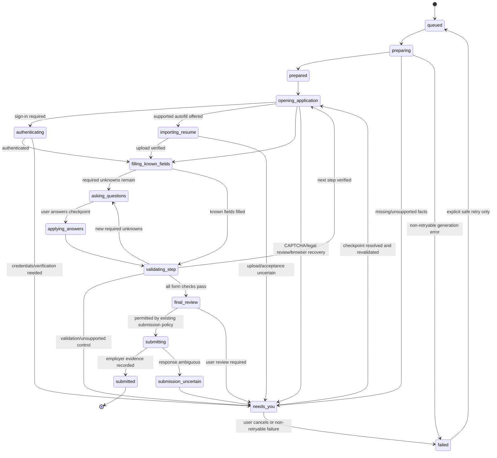

# Daymark Job Application Agent Architecture

## Goal

Extend Daymark's existing resume and application workflow into a recoverable job-application agent. Keep the dashboard/API, task IDs, task statuses, question IDs, checkpoint shape, generated documents, and Proton Bridge boundary compatible with the current local installation.

## Per-application orchestration

Each application is a durable orchestration record keyed by the existing `jobId` and `taskId`. The coordinator owns the application lifecycle and schedules bounded worker jobs; workers report results and checkpoints, but do not independently advance the application state. A worker attempt is identified by `(taskId, phase, attempt, checkpointId)` so retries can be deduplicated and stale results rejected.

Use phase jobs and worker pools rather than starting a new container for every application. Keep one API process, one queue consumer initially, and one browser-profile lease. Document-generation and dialogue jobs are short-lived logical jobs; ATS automation runs only through the single browser owner. This supports later concurrency for isolated tasks without permitting two workers to control the same employer session or profile.



`needs_you` is a durable wait state with a typed reason, current checkpoint, recovery link where safe, and an optional dialogue thread. It is not a generic failure. The existing public statuses (`queued`, `running`, `needs_you`, `ready_for_review`, `completed`, `failed`, `paused`, `cancelled`) remain compatible; the finer phases are exposed as optional `stage`/activity values and persisted in task state. `submitted` is represented only by existing completion status plus recorded submission evidence, never by a worker's optimistic click result.

### Worker responsibilities and parallelism

| Worker role | Runs when | Owns | Must not do |
| --- | --- | --- | --- |
| Resume/profile extractor | Resume upload or explicit re-parse | Extraction result and source spans for editable profile fields | Confirm facts or alter browser state |
| Materials worker | Application enters preparation | Resume and cover-letter drafts, provenance/change set, requested outputs | Invent experience, change identity/dates/employers, or approve its own suggestions |
| ATS browser worker | Application is ready to fill or resume | Exclusive Playwright page/profile lease, adapter actions, live form snapshot, verification | Handle another task in the same profile concurrently or bypass checkpoints |
| Dialogue/question planner | Preparation and form checkpoints | A queue of concise questions with field context, options, required flag, and answer provenance | Touch Playwright, submit answers without a user response, or ask for facts already confirmed |
| Validation/recovery worker logic | After each fill/answer/restore | Checkpoint freshness, field verification, loop and retry decisions | Retry a non-idempotent submit or claim stale success |

Materials preparation and profile-grounded question planning may run in parallel from the same immutable input snapshot. Once the ATS worker discovers employer-specific questions, it emits a versioned question checkpoint; the dialogue planner groups and presents those questions while the browser worker releases the profile lease and waits. On user response, the coordinator validates `checkpointId` and question schema, records the answer, and schedules the browser worker to reacquire the lease, re-read the live page, then apply and verify. Do not keep a browser session spinning while waiting for a person.

The dialogue is a Daymark screen, not a second browser agent. It should show one focused question at a time (with a compact queue and progress), exact employer wording and choices, why the answer is needed, whether it is required, and whether a saved profile fact or answer-pack item already answers it. Ask before reusing uncertain facts. Legal consent, work authorization, demographic disclosures, CAPTCHA, and credentials remain explicit user checkpoints; do not infer or auto-accept them. Saving an answer to the reusable answer pack remains an explicit opt-in.

### Phase contract and recovery

1. **Create:** API creates/reuses the current Daymark task shape, persists its initial revision, and dispatches only its task ID. A stable idempotency key prevents duplicate phase jobs.
2. **Prepare:** profile extraction (when requested) and materials generation consume a versioned snapshot. Outputs include provenance and are attached to the task; results from an older profile/resume revision are discarded for review.
3. **Inspect/fill:** coordinator acquires the browser lease; the ATS adapter resolves the employer/application identity, captures a page signature, applies only grounded known facts, verifies each field, and persists a checkpoint before yielding.
4. **Ask/wait:** unknown required answers create or refresh the checkpoint. The API serves it to the existing processing screen. No browser worker owns the profile while waiting for user input.
5. **Apply/resume:** answers carry the checkpoint ID and question schema version. A mismatch returns a conflict and fresh questions. The worker reacquires the lease and checks that the same employer and current step are still present before changing fields.
6. **Review/submit:** existing final-review and submission policy remains authoritative. Before submitting, verify identity, required fields, attachments, employer validation, and an unambiguous control. Record the attempt before clicking; after an ambiguous outcome, inspect for evidence and enter `submission_uncertain` instead of clicking again.

Persist phase, revision, worker attempt, lease owner/expiry, checkpoint ID and signature, user-answer draft references, retry classification, and last progress time. Secrets, full credentials, private browser locators, and raw authentication URLs stay out of public task state and queue payloads. Checkpoints remain compatible with the current public checkpoint shape; add optional fields and internal journal data rather than replacing identifiers or routes.

Retries are phase-specific: document generation may retry a bounded number of times with the same input revision; navigation may retry transient failures after saving a checkpoint; answer application can retry only after live form revalidation; submission never retries automatically after an attempt was recorded. The watchdog can reclaim an expired worker lease, mark the prior attempt interrupted, and enqueue safe recovery from the last durable checkpoint. It must not label interruption as completion.

### Suggested implementation increments

1. Add a coordinator module and explicit allowed-transition table around the existing task updates; keep the same task API and status strings.
2. Add phase-job identity, idempotent enqueue, lease/heartbeat fields, and PostgreSQL event/checkpoint records; keep Redis payloads limited to `taskId` plus a non-sensitive phase/attempt token if needed.
3. Extract materials and dialogue planning behind small worker functions that return typed results and never access the browser.
4. Make the ATS worker yield its profile lease at user checkpoints and reacquire/revalidate on answer submission or recovery.
5. Add fixture tests for illegal transitions, duplicate events, stale answers, concurrent browser claims, worker crashes at every phase boundary, and ambiguous submission recovery.
6. Wire the processing screen to render the dialogue queue and lifecycle phase from task state, preserving current routes and user interactions.

Do not increase browser-worker concurrency until profile isolation, separate browser contexts, and cross-task lease tests prove that one application's session cannot affect another.

## Existing components to reuse

- NVIDIA-confirmed resume-to-profile extraction and the editable master resume in `resume-mapping.mjs` and `public/workflow.js`.
- The host API and single ARM64 Docker Playwright worker in `server.mjs`, `worker-runtime.mjs`, and `docker-compose.worker.yml`.
- ATS-specific and dynamic adapters, question extraction, answer validation, attachment verification, and submit evidence.
- The shared task model and `/api/state`, `/api/tasks/:id`, answer, resume, pause, recovery, and handoff routes.
- The host-only Proton Bridge / macOS Keychain boundary.

## Target runtime

```text
Local browser UI
      │ existing HTTP contract
      ▼
Mac API ───── PostgreSQL (task state + checkpoint journal)
      │                         ▲
      └──── Redis/BullMQ ───────┘
                │ one owned queue consumer
                ▼
       ARM64 Docker Playwright worker
       ├── pinned Chromium + scoped profile volume
       ├── ATS adapter / application-flow engine
       └── checkpointed field verification

Mac API ── Proton Bridge + Keychain (mailbox remains host-only)
```

PostgreSQL and Redis are additive local services. When their URLs are absent, Daymark remains in its current JSON-state and file-polling mode. When configured, PostgreSQL becomes the shared state store and records checkpoint snapshots transactionally; Redis/BullMQ dispatches task IDs to a worker with concurrency one. Redis messages contain task identifiers only, never resume text, answers, credentials, or browser locators. The existing JSON document is imported once when PostgreSQL is first enabled; reverting to JSON requires an explicit state export rather than silently falling back to a stale file.

## Invariants

- Existing public API response shapes are extended only with optional fields.
- PostgreSQL updates preserve the existing revision-aware state merge and import `data/state.json` once when the database is empty.
- Queue delivery is at-least-once; state/task identity and the single-owner lease prevent duplicate execution. A prior submit attempt is never replayed automatically.
- A checkpoint records employer identity, step, question signature, safe recovery URL, and captured fields. Locators remain private to the worker and are not sent through Redis or public APIs.
- Every write is checked against the live employer form and verified after entry. Changed questions cause a fresh human-review checkpoint.
- Repeated application steps and step-limit exhaustion stop in a visible human-review state; they do not progress to submission.
- Missing facts, authentication, CAPTCHA, legal attestations, unclear controls, validation failures, and uncertain submission remain explicit human-review states.
- Docker restart plus the worker watchdog restores safe tasks from saved checkpoints; a task with a submit attempt becomes `Submission unconfirmed` and is never clicked again without confirmation.
- Proton Bridge credentials and mailbox access remain on macOS. The Docker worker receives neither Keychain access nor mailbox credentials.

## Data and queue contracts

PostgreSQL holds the existing state document as the compatibility record plus a latest-checkpoint table and append-only checkpoint snapshots. The JSON file remains the one-time import source and the supported fallback. The task API continues to consume the existing state document.

BullMQ jobs contain `{ taskId }` only. The worker validates that the current state still contains a queued task before execution. It claims one task at a time, keeps the existing worker lease, and periodically reconciles queued state into Redis so a Redis restart does not lose work.

## Application flow

1. Extract PDF/DOCX text locally, then request explicit NVIDIA consent before mapping resume evidence into editable profile fields.
2. Resolve the posting and ATS adapter, follow supported redirects, and identify the current application step.
3. Fill only profile facts and user-approved answers; pause on unknown required information.
4. Re-capture the form after dependent answers, verify each value, and compare the live question signature with the saved checkpoint.
5. Detect repeated step fingerprints and navigation cycles; stop with a recovery link and human-review reason.
6. Verify tailored attachment, employer identity, required fields, and validation state before any user-authorized submission path.
7. Save employer confirmation evidence before marking an application submitted.

## Rollout

1. Add the PostgreSQL compatibility state store and checkpoint journal with JSON migration and offline unit tests.
2. Add Redis task dispatch while keeping the existing state reconciliation loop and worker lock.
3. Add explicit application-flow loop detection, field-verification outcomes, and structured human-review reasons.
4. Add worker heartbeat/watchdog recovery and report stale active tasks without retrying uncertain submissions.
5. Add local ARM64 PostgreSQL/Redis Compose services, setup instructions, and fixture-backed restart verification.

The feature is opt-in until local data migration and safe recovery tests pass. No live application is submitted as part of this architecture work.
